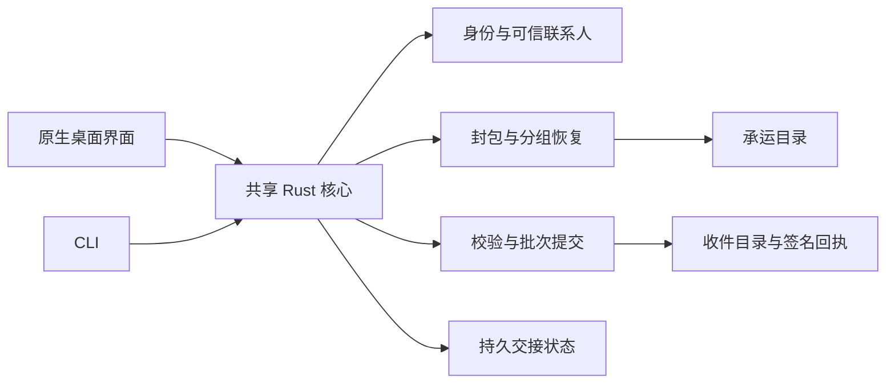

# 驿站 Kiroween 2026 项目方案

版本 v0.2 提交候选 · 2026 年 11 月 2 日 · 产品与工程方案

驿站（工作名 RelayPost）是一款 Rust 本地桌面应用和 CLI，把一批文件封装成可修复、可验证、可返回签名回执的离线邮包。设备不需要同时可达；邮包可以由用户选择的 U 盘或交换目录承运。

本项目选择 Kiroween 2026 的 Resurrection 赛道。主要复活对象是 **UUCP 的存储转发范式**，辅以 Usenet 恢复卷的冗余修复思路；现代实现采用 Rust、age、Minisign 和 Reed–Solomon 擦除编码。现已实现共享 Rust 核心、CLI、原生界面、首次使用引导和隔离分步演示；源码与实际验收记录见 README、远端 CI 和 Kiro 证据。真实双机／物理载体效果、相对基线收益与实测性能仍待验证，正式公开发行和参赛提交须以最终交付验收为准。

## 一 项目定义与选择理由

### 选择哪项旧技术

UUCP 把发送请求和数据保存在本地队列，在链路可用时逐跳转发，并通过后续处理完成交付。这种存储转发方式适应间歇连接，也允许源端与最终接收端通过中间节点错开在线时段。驿站保留“投递意图持久化、载体可以延迟、确认可以晚到”的模型，把物理介质视为一种承运路径，而不是要求两端保持实时会话。[历史实现手册](https://www.uupc.net/UUPC-Manual.htm)

旧的是拨号时代的部署与操作条件，不是说存储转发已经完全消失。NNCP 是今天仍可使用的成熟继承者，已有加密、认证、介质承运、去重和 ACK。驿站不声称首次复活这些能力，也不实现 UUCP、FidoNet 或 NNCP 的协议兼容。[NNCP 官方说明](https://nncp.mirrors.quux.org/)

### 打算用什么现代技术复活

| 旧机制 | 本项目保留什么 | 现代实现选择 |
|---|---|---|
| 存储转发与发件队列 | 发送意图跨关机与承运保留 | Rust 核心、不可变邮包、本地持久状态 |
| 收件确认与重投 | 没有回执时不误判送达，重投复用同一邮包 | 接收端签名回执、身份固定、批次幂等 |
| 恢复卷／冗余数据 | 部分内容损坏后可在接收端重建 | 对密文进行分组 Reed–Solomon 编码 |
| 节点与联系人 | 预先知道应交给谁、接受谁的确认 | 本地双密钥身份、联系人卡和指纹核对 |
| 面向管理员的操作步骤 | 把准备、恢复、提交与回执组织为连续任务 | 原生桌面界面与共享同一核心的 CLI |

正式实现采用一条 Rust 路线：应用核心、CLI 和桌面端均由 Rust 开发，复用现有库提供加密、签名和擦除编码。**NNCP 仅作为比较基线与状态设计参考，不作为 Go 侧车，也不把它的 packet ACK 名称混入本项目的业务状态。** 这样首版只承担双端文件批次交接，不扩展为网络节点、邮件、多跳路由或远程命令平台。

### 为什么值得做验证

真实使用者已经记录过：离线交换需要正确保留待发副本，回执清理和重传规则容易理解错误；物理介质会损坏，交付确认可能要随介质往返。Solène 和 John Goerzen 都提供了能工作的实际流程，而不是只有问题描述。[Solène 的实践](https://dataswamp.org/~solene/2024-10-04-secure-file-transfer-with-nncp.html)；[可靠离线承运实践](https://www.complete.org/dead-usb-drives-are-fine-building-a-reliable-sneakernet/)

项目要验证的收益是：将加密、修复、批次保存和回执核对收敛成更少人工编排的连续操作。在缺少可访问正确副本时，随包冗余还可能减少一次物理重传等待。**与 NNCP 加 PAR2 的完整配置相比，新增收益主要是工作流成本和误判减少，不是发明了新的传输或修复能力。**

### 优点与代价

| 预期优点 | 必须接受的代价 |
|---|---|
| 不依赖双方同时可达或常开中转服务 | 投递和回执有物理延迟，无法显示远端实时状态 |
| 接收端可以尝试修复额度内的损坏 | 增加存储与计算开销；局部集中损坏可能超过某组预算 |
| 内容与接收对象明确绑定 | 首次配对、私钥保管和丢失处理不可省略 |
| 批次级验证、提交与幂等接收可核查 | 必须处理文件系统、状态库和回执之间的崩溃窗口 |
| CLI 与界面共享一套行为 | 需维护公开格式、依赖版本和目标平台发行 |

### 与现代替代品的关系

| 基线 | 已有优势 | 驿站需要证明的增量 |
|---|---|---|
| AirDrop／LocalSend／Syncthing | 即时分享或目录同步成熟；Syncthing 可借常开第三节点衔接终端 | 在没有并发可达时段和常开节点时，介质交接是否更直接 |
| NNCP＋PAR2／Filespooler | 专家已能组合加密、队列、修复、重传和确认 | 首次配置、重复交接、故障恢复及状态判断是否明显省事 |
| WinRAR 恢复卷／PAR2 | 已有部分损坏修复能力 | 能否把恢复、接收人、批次入库和回执自动关联 |
| Kionel | 已开源的离线校验、签收和独立验证 | 其 USB 路线不加密文件；完整加密修复交接是否有额外任务价值 |
| OffShoot／MediaVerify 等 | 队列、校验、MHL 和收件验收成熟 | 没有可访问正确副本时的包内冗余恢复，而非只比较校验按钮 |

这些是比较任务，不是声称现有工具完全做不到。基线应获得合理配置机会；已经拥有稳定脚本或组织交接系统的用户，可能没有换用驿站的理由。[NNCP ACK](https://nncp.mirrors.quux.org/ACK.html)；[Filespooler](https://www.complete.org/filespooler/)；[Kionel 边界](https://kionel.com/limits.html)；[OffShoot 校验与重拷](https://docs.hedge.video/offshoot/features/verification)

图形化异步产品 Sideband／LXMF、Briar 也必须纳入对照：它们已有加密消息、附件或离线消息相关能力，不能把原生 GUI 或异步本身当成新意。本项目比较的是可修复文件批次、目标入库和回执往返整链；本轮未实测的物理承运行为不写成“不支持”。[Sideband](https://github.com/markqvist/Sideband)；[Briar Mailbox](https://www.briarproject.org/mailbox/)

## 二 使用场景与产品体验

### 目标用户与场景

首轮验证优先找已有离线归档或跨设备承运经验的人；现场研究和非技术交接人员属于后续待验证人群，不视为已经确认的市场。

| 场景 | 触发条件 | 用户希望得到的结果 |
|---|---|---|
| 个人跨地点归档 | 两端不同时开机，使用介质交接一批资料 | 明确这一批是否完整进入目标位置 |
| 现场数据带回 | 原源端暂时不可达，承运文件有缺失或损坏 | 在冗余额度内自行恢复，超过能力时知道缺什么 |
| 长周期人工交接 | 同一批资料可能被重复带入，回执晚于数据返回 | 不重复生成收件目录，不把已导出当作已送达 |

双方可以直接连接、只需普通目录同步，或者已经拥有成熟交接流程时，优先使用现有工具。首版不承担杀毒、内容净化、端点防护或绕过介质使用限制的职责。

### 一条完整用户旅程

1. 在各自设备创建本地身份，交换联系人卡，通过当面或已信任渠道核对完整指纹并固定信任。
2. 甲选择静止的普通文件和乙，查看文件清单、实际邮包大小与修复预算，封包后导出到承运目录。
3. 乙导入邮包，先核实可信签名及资源上限，再检查分片；在可恢复条件下重建密文并执行解密和文件验证。
4. 乙将整批资料提交到独立收件目录，应用生成绑定本批内容的签名回执。
5. 回执随获准载体返回甲，甲验证后显示“收件机已确认保存”；再次承运同一邮包不生成第二份交付。

### 首版界面

| 页面 | 唯一主要任务 | 关键反馈 |
|---|---|---|
| 发件 | 选择接收者、文件并生成／导出邮包 | 实际大小、联系人是否已核验、已导出但待回执 |
| 收件 | 检查、修复、验证并提交一个邮包 | 按组显示缺片与修复结果，失败原因及下一步 |
| 交接记录 | 查看每批已知事实并导出回执 | 本机事件与对方签名声明分开；回执与批次明确对应 |
| 身份与联系人 | 解锁身份、导入联系人卡和备份 | 公钥指纹、核验状态、旧邮包绑定的身份不被静默替换 |

界面采用清晰的投递阶段和分组块图表达真实结果。块图来自实际分片校验状态，不播放假恢复动画。技术参数放入可展开详情；普通用户主要看到“可以恢复”“无法恢复”“已保存，回执待带回”等操作结果。

### 预期效果与失败边界

演示目标是：甲不在线时，乙从部分分片缺失的承运目录中恢复出逐字节一致的原文件；正确副本在目标目录出现后，乙生成回执；回执返达前，甲始终保持待确认。

哈希只能识别一致性，不能恢复数据；纠删码负责重建，不能代替身份认证。整盘丢失／完全不可读、关键元数据均不可用、私钥遗失或某组损坏超过预算时，必须报告无法完成。源文件封包前就已错误，邮包也不能识别其业务真伪。回执仅证明相应接收密钥对约定处理结果作过签署，不代表有人阅读、法律签名或永久存储保证。

## 三 技术方案与实现边界

### 共享 Rust 核心

工程按 `relay-core`、`relay-cli`、`relay-desktop` 三个 crate 组织。核心处理邮包格式、身份、分片、验证、提交和状态；两个入口只负责交互。没有云服务、账号系统或运行时 AI 依赖。Kiro 用于真实开发过程，不进入用户交接链路。

### 技术选型与职责

| 职责 | 首版选择 | 不由它承担的责任 |
|---|---|---|
| 接收人加密 | Rust `age` 库，邮包仅用接收人公钥模式 | 不证明发送者身份，不以共享口令作为投递鉴权 |
| 身份与签名 | Rust `minisign`，发送清单与回执分别签署 | 不自动证明公钥属于某个现实中的人 |
| 损坏修复 | `reed-solomon-erasure` 的 GF(2⁸) 分组编码 | 不检测未知坏片、不代替认证、不保护整盘丢失 |
| 本地数据与文件 | SQLite 持久交接状态、标准归档与 SHA-256 | 不构建网络文件系统或全目录原子快照 |
| 原生界面与 CLI | `egui/eframe`、`clap`，共享核心及错误模型 | 不另写一套界面专用协议逻辑 |

依赖在实现时通过远端 CI 验证目标平台，再锁定版本与许可证清单。编码库先使用默认 Rust 后端，不默认打开针对特定 x86 架构的 SIMD feature；优化需另经目标平台验证。首版使用 Reed–Solomon 一个修复实现，不并行维护 RaptorQ／PAR2 多后端，也不为 NNCP 增加兼容层。[age](https://github.com/str4d/rage)；[Minisign Rust](https://github.com/jedisct1/rust-minisign)；[Reed–Solomon Rust](https://github.com/rust-rse/reed-solomon-erasure)；[egui](https://github.com/emilk/egui)

### 身份与信任

每个设备身份包含独立的 age 解密密钥和 Minisign 签名密钥。联系人卡绑定两把规范公钥及格式版本，联合指纹由固定格式的公钥字节计算；显示名称仅为标签。联系人卡自签名只证明两把 key 的绑定，首次仍需经可信渠道核对指纹。未知或未核验联系人不能自动成为信任根。

邮包不携带私钥。私钥与备份在本地用口令加密，解锁材料不写入日志、命令行参数或导出物；口令加密身份备份与“邮包接收人加密模式”是不同用途。没有云端找回。轮换密钥时创建新的明确绑定；已发邮包仍检查封包时固定的回执签名 key，不因联系人条目变化而自动信任新 key。

取消只停止本地继续投递，不能召回已经导出的副本。丢失旧私钥可能使旧邮包或回执无法继续处理，必须通过备份恢复或重新配对后创建新邮包，不能偷偷改写旧身份。

### 邮包格式 v1

承运物采用目录包，不依赖一个容易因中央目录损坏而整体打不开的外层压缩包。目录包含固定位置的签名信封副本，以及按组存储的数据与冗余分片。信封两份副本必须是完全相同的已签字节；导入时若出现同一邮包的不同有效信封，按冲突拒收，不任意挑选。

| 数据 | 包含内容 | 绑定方式 |
|---|---|---|
| 外层信封 `envelope.json` | kind／schema、发件签名指纹、收件加密与回执签名指纹、密文长度、组参数、各分片摘要 | 对保存下来的原始字节签名；验证时不先重排 JSON |
| 邮包身份 `parcel_id` | 完整 age 密文的 SHA-256 | 重建密文必须与该 ID 一致；同一 ID 的不同信封视为冲突 |
| 密文内清单 | 规范相对路径、原始长度、每文件 SHA-256 与内容顺序 | 与文件一同加密，避免把原文件名放在外层 |
| 业务回执 | kind／schema、parcel_id、信封摘要、文件清单摘要、收件签名身份、committed 结果及本机时间 | 由封包时指定的接收签名 key 签署 |

所有协议字段、参数和允许路径都采用 v1 明确规范。签名验证与严格字段解析共同执行：拒绝重复字段、未知关键版本、超限长度和不安全路径。不把邮包中附带的一把陌生公钥当作已经受信任的发送者。

### 封包与修复顺序

源端先把选择的文件复制成应用拥有的内容快照，检查读取期间的常见变化，生成文件清单并完成归档。用户输入必须已停止写入；v1 不承诺全文件系统的原子快照。随后完成并关闭 age 密文，计算 parcel_id，再分组生成数据及冗余分片、计算摘要、签署信封。封包完成后内容不可变；再次导出同一投递复用原字节，新一轮主动发送另建邮包。

接收端先检查可信身份、信封签名、格式和资源上限，再按签名信封中的摘要把缺失或损坏的分片标成擦除。只向重建器提供有效分片。全部组恢复后，重新检查完整密文摘要与原 parcel_id，再 age 解密认证、检查内部清单、路径、文件数量及逐文件摘要，最后才进入提交阶段。

满组固定 **20 个数据片＋4 个冗余片**，每片最大 1 MiB，每组独立恢复。尾组取实际数据片数并生成向上取整的 20% 冗余片，记录真实长度和补齐规则，移除填充后再验证密文。每组最多 4 个缺失／已识别坏片是满组能力；同组坏 5 片时其他组的健康数据不能救它。20% 是满组相对数据的额外存储开销，不是任意全盘损坏比例；小包、尾组和元数据会使实际开销更高，界面按实际字节显示。

尾组长度为 L 字节时，数据片数 n 为 L 除以 1 MiB 向上取整，每片长度为 L/n 向上取整，按顺序切片后将最后不足部分补零；冗余片数 r 为 n/5 向上取整。信封固定记录 L、n、r 和片长，重建后的数据片串接后截回 L，不能用未经验证的尾组长度解释输出。

v1 格式边界为：单信封最多 64 KiB、密文最多 80 MiB、最多 4 组；每组数据片 1–20 个，冗余片数固定为数据片数的五分之一向上取整，总片数不超过 24，片长不超过 1 MiB。封包后只读取已签信封列出的安全分片路径；外层目录的额外条目列为诊断，不读取为邮包内容。内层清单最多 256 KiB、路径深度最多 16 层、单路径 UTF-8 最多 1024 字节；实际输入与文件数量仍受 MVP 上限约束。这些数值是首版设计限制，需由 CI 边界测试确认。

### 批次提交与回执

接收端只向指定收件根目录写入应用拥有的 staging 子目录。v1 拒绝绝对路径、上级路径、特殊文件、符号链接、大小写／规范化冲突和覆盖既有文件；以普通数据保存，不自动执行收到的内容。

包内路径统一使用正斜线，拒绝反斜线和 `.`／`..` 路径组件。首版一致性承诺是清单中的相对文件名与内容字节，不承诺保留原始权限、所有者、扩展属性或完整文件系统语义。内层未在清单声明的条目拒绝提交。

完整验证后，同步文件和相关目录，在相同文件系统内将整批发布为 `inbox/<parcel_id>/`，采用不覆盖策略。系统持久化调用成功并不构成对所有硬件永久耐久的保证；重启后还要复核提交标记与清单。只在这一步完成后生成签名业务回执。跨盘 staging 不作为原子提交实现。

同一已提交邮包再次导入时，先核对信封与本地记录；不创建第二个目录。若外部修改或删除了本地收件结果，转异常提示，不静默覆盖或假称当前副本完整。提交成功但生成回执前崩溃时，重启根据提交标记与清单恢复回执生成。历史回执证明当时的约定处理完成，不保证之后文件从未被人改动。

源端必须把签名回执与原 parcel_id、信封摘要、预期接收签名 key 和文件清单绑定匹配后，才结束待确认状态。保留封包副本至此或用户取消；清理只针对应用拥有的缓存，不自动删除用户原文件。

提交顺序固定为：在收件根目录同盘 staging 下准备 `files/`；验证后将原信封、内部清单及 `prepared.json` 放入该批次的 `.relaypost/` 元数据区；同步文件和目录；按 parcel_id 串行化，用平台的原子不覆盖重命名原语发布为 `inbox/<parcel_id>/`，同步父目录；把回执及签名作为一个完整目录持久发布，最后记录接收索引中的“已保存、回执就绪”。不能提前在索引宣称回执已就绪，也不能用先检查不存在再普通 rename 替代不覆盖提交。

macOS 首版以本机 APFS 收件库作为验证目标，需检查目标卷对 exclusive rename 的支持并核验实际系统 API；不满足提交条件时拒绝该目标，不退化成跨盘复制。承运目录可以在可移动介质上，但它与最终收件库是不同角色。[Apple 的 exclusive rename 能力说明](https://developer.apple.com/documentation/foundation/urlresourcevalues/volumesupportsexclusiverenaming)

`prepared.json` 记录 parcel_id、双方身份、信封及内容清单摘要，不在 staging 中预先宣称已提交。接收端认定提交的依据是发布目录及经复核的完整元数据和文件内容；SQLite 是已提交内容的索引，不能反向掩盖文件缺失。源端待投递意图仍须持久保存，不能从接收目录推断远端状态。

| 中断点 | 重启时的事实 | 恢复规则 |
|---|---|---|
| 发布前 | 仅 staging 存在 | 完整 prepared 批次复核后继续发布；未完成或冲突的批次保留为 pending，由用户显式丢弃 |
| 发布后、索引前 | 最终目录可能存在，SQLite 尚未完成 | 复核元数据与文件并执行同步，补齐回执和索引；只在最终批次与暂存批次一致时清理残留临时副本 |
| 索引存在、回执缺失 | 历史索引与磁盘不一致 | 复核发布内容后恢复回执，重新记录就绪状态 |
| 回执发布后、索引未记录 | 完整回执目录存在 | 验证自身签名与批次绑定，重用回执并修复索引 |
| 外部修改收件目录 | 文件与已存清单不一致 | 转异常，不覆盖、不自动重签或导出新的成功回执；历史证明与当前完整性分开 |

显式丢弃入口位于 History 的恢复区域，需要确认；CLI 使用 `recover --discard-incomplete`。只清理当前 profile 私有 `inbox/.staging/batch-*` 目录，不影响已提交批次、载体邮包或原文件。部分暂存不能直接生成回执。

发件机将已验证的返回回执与原始签名信封一起原子保存为本地 acknowledgment。启动恢复时先验证这组独立证据，再检查本地 outbox 分片；本地副本损坏或缺失时，仍能恢复已确认保存的远端事实。承运回执保持 JSON 与签名两个文件，本地 acknowledgment 固定增加原信封与其签名，不保留旧内部格式的回退解析。

### 状态模型

| 所在端 | 对用户显示的状态 | 成立条件 |
|---|---|---|
| 源端 | 草稿／封包中／可导出 | 本地准备进度，尚无远端含义 |
| 源端 | 已导出，待回执 | 指定承运目录已写入并完成本地验证 |
| 收件端 | 检查／修复／验证中 | 仅代表本机处理，不能提前称文件已保存 |
| 收件端 | 已保存，回执待带回 | 批次提交条件成立，业务回执已持久保存 |
| 源端 | 收件机已确认保存 | 收到并验证完全匹配的业务回执 |

本项目不存在 NNCP packet ACK 事件。载体检查通过仅是内部阶段，不是最终回执。手工标记“已交给承运人”只能作为备注，不能改变机器验证状态。本地时间和接收者声明时间分开显示，不提供第三方可信时间戳。

发件投递阶段与本地副本健康分开保存：`local_error` 提示本地保留副本的问题，不能把已导出的 `WaitingReceipt` 覆盖为 `Failed` 后再恢复成 `Ready`。恢复健康副本只清除健康告警；已确认与已取消的历史事实继续保留。首版联系人必须属于另一个身份，拒绝导入、信任或投递给自身；界面记录选择仍以 `(parcel_id, direction)` 为键。

## 四 首版范围与工程验收

### MVP 范围

1. macOS 优先，两个独立设备身份，一对一联系人，不含多跳、群发或常开服务。
2. 每批原始输入总计不超过 64 MiB、最多 100 个静止普通文件；邮包实际磁盘占用另算。
3. 一个承运目录、一个固定冗余档，手动导出／导入，不做目录同步或自动发现。
4. CLI 完成真实封包、修复、验证、批次提交与回执往返；桌面入口随后复用同一核心。
5. 错误、中断、重复导入和本地记录恢复明确可检查；不实现自动补块请求、聊天或远程命令。

封包前检查可用空间并显示保守预计占用，封包完成后显示准确邮包大小；接收前检查暂存和输出空间。解码按组进行，不一次加载整个大文件。格式解析限制组数、分片大小、目录深度、文件数、总字节和执行资源。性能目标与最大内存必须由远端构建及目标机器测试确认，不写虚构吞吐数字。

### 四阶段排期

| 阶段 | 交付物 | 放行条件 |
|---|---|---|
| D1–D2 | 格式 v1、可信身份、加密／签名与编码库最小整合 | 远端 CI 构建，密文与元数据正常往返 |
| D3–D7 | CLI 全链、固定修复档、提交与回执、故障测试 | 正常、额度内损坏、超限、中断及重复导入全部满足核心不变量 |
| 第 2 周 | 原生界面、两台目标 Mac 与真实介质验证 | 两个进程测试不冒充双机；用户能正确识别待确认和已保存 |
| 第 3–4 周 | 安装包、边界打磨、对照实验和英文材料 | 干净目标账户可按说明运行，效果与限制均有证据 |

全部代码通过远端流水线构建和测试，不在本地执行项目编译。依赖锁定、许可证、格式版本与发行摘要进入仓库；CI 构建成功不自动等于目标平台已经获得实际支持。Apple 签名／公证凭据尚未确认，发布前需真实解决安装路径，不能预先宣称已公证或跨平台无差异。

### 核心验收矩阵

| 测试组 | 条件 | 必须成立 |
|---|---|---|
| 正常与受信任身份 | 正常包、陌生 key、错误接收人、信封与回执篡改 | 正常逐字节一致；其余拒收／不确认，不泄露明文 |
| 额度内损坏 | 同一满组分别缺失或被摘要判坏 0–4 片，包括 parity | 实际重建后密文和所有原文件摘要一致，才能提交 |
| 超额与关键材料丢失 | 同组坏 5 片、信封副本全坏、私钥丢失、整盘丢失 | 不虚构成功，不产生已保存回执，给出明确恢复边界 |
| 中断与空间错误 | 在封包、修复、提交前后、回执生成前终止进程；模拟空间不足 | 不丢投递意图、不发布半批次；重启按持久事实恢复或报错 |
| 重投与冲突 | 同包重复导入、同 ID 不同信封、目的目录被外部修改 | 不重复入库、不静默覆盖、不接受冲突回执 |

另需检查路径穿越、符号链接、非 UTF-8 或不安全路径、输入写入中、错误组参数、异常长度、损坏内层归档和资源耗尽。进程终止测试不能冒充真实断电耐久测试；后者若未执行，交付说明不声称已验证。

编码层另覆盖尾组数据片数 1–19、实际冗余数 r、恰好丢失／判坏 r 与 r+1 片、混合数据和 parity 损坏、原始长度和填充恢复，以及编码输入在 20 MiB 组边界前后各一字节的情况。UI 必须使用该组真实预算，不统一显示“可坏四片”。这些编码测试与有效 age 密文的端到端测试分别执行。

### 产品增量与淘汰闸门

使用同一组数据、相当修复冗余、相同损坏点及同等准备程度，对比 NNCP 加 PAR2 的成熟脚本、Kionel 加合理外部工具，以及恢复卷加人工交接。首次配对配置与重复批次操作分别记录，不能用预配置的驿站对比每次重新搭建的竞品。

记录安装与配置、手工步骤、文件匹配、恢复操作、最终字节一致性，以及操作者是否正确判断“仍待回执／收件机已确认”。若只换了窗口，不能明显减少人工编排或状态误判，应停止扩展界面并淘汰或调整题目。不用“市场上绝对没有同类”代替这个实验，也不把研究阶段推荐写成已证明 PMF。

## 五 比赛呈现与交付

### Resurrection 与 Kiro

参赛叙事是把间歇连接时代的存储转发工作流，重构为现代本地交接工具，展示旧机制在今天的适用条件。恢复卷作为辅助设计来源，不声称 UUCP、NNCP 或 Reed–Solomon 已经消失，也不声称本项目发明它们。

Kiro 用于真实的需求规格、实现、故障修复和测试工作。仓库保留实际产生并使用的 specs、steering、hooks 与提交对应记录；hooks 不自动触发本地编译，而用于规范检查或远端 CI 流程。用户操作链不需要 AI 账号。Kiro 安装、登录与额度状态在开发前确认，不能用手写目录冒充使用证据。

### 三分钟演示脚本

| 时间 | 操作 | 可见证据 |
|---|---|---|
| 00:00–00:25 | 展示两个独立身份、网络条件和待交接文件 | 说明实际使用双机还是隔离进程，承运目录是否模拟 U 盘 |
| 00:25–00:55 | 甲封包导出，甲停止运行；损坏测试副本中的额度内分片 | 实际文件清单、密文与分组预算；不改用户原文件 |
| 00:55–01:45 | 乙检查、修复、验证并提交 | 真实缺片／坏片识别、原文件哈希、目标目录、签名回执 |
| 01:45–02:25 | 重复导入，回执返回甲 | 无第二份收件目录；甲在验证回执后才更新为已确认 |
| 02:25–03:00 | 展示超额失败与真实 Kiro 开发证据 | 不产生虚假成功；spec、测试与 CI 记录可以对应 |

### 五项评分的证据

| 评分项，各占 20% | 需要呈现的事实 |
|---|---|
| 实际价值 | 真实不同时可达交接任务和与现成流程的对照结果 |
| 技术实现 | Kiro 真实使用、加密／编码／提交不变量、远端 CI |
| 设计 | 用户可正确区分已导出、可修复、已保存和回执返达 |
| 创新 | 整条任务的可测收益，承认各单项能力已有现代基线 |
| 演示 | 短时间展示真实产物、成功边界与失败结果 |

### 参赛交付与时间

1. 公开 GitHub 仓库、开源许可证、根目录 `.kiro/`、依赖来源与构建流程。
2. 实际支持平台的 CLI／桌面安装包、摘要、英文安装与使用说明、可重复演示资料。
3. 英文项目介绍、旧机制与现代基线、Kiro 用法、结果和已知限制。
4. 公开 YouTube 演示，短于三分钟；演示条件与错误注入方式如实说明。
5. 提交表单的运行访问／下载链接持续可用，不在提交后立即撤掉构建或说明。

全部为北京时间：2026 年 **12 月 2 日 04:00** 前申请比赛 credits；**12 月 5 日 06:00** 前完成提交；评审访问至少维持至 **2027 年 1 月 30 日 05:00**。新项目、提交材料和评分以[官方规则](https://kiroween.devpost.com/rules)与[比赛说明](https://kiroween.devpost.com/)为准。

### 主要风险与当前状态

| 风险 | 当前处理 |
|---|---|
| 相对成熟脚本的收益不足 | 原型后做公平对照，不因已写界面就放宽淘汰标准 |
| Crypto 与格式集成出现错误 | 复用成熟实现，签名、资源、身份、认证各自有独立测试；不宣传已安全审计 |
| 文件系统崩溃窗口与原子性 | 独立批次目录、同盘 staging、不覆盖提交、重启复核；不承诺所有硬件永久耐久 |
| 平台发行和私钥保管 | 先验证目标平台，完善加密身份备份及轮换规则，发布前解决安装问题 |
| 赛道叙事或范围膨胀 | 聚焦一对一离线邮包，真实展示旧机制的新工作流，不做完整 NNCP 或通用同步平台 |

截至本版：0.2.0 工程候选已实现首次使用引导、共享演示引擎与真实封包／损坏／恢复／回执链路。Kiro 实际参与规格与实现，Codex 负责独立审阅、修正、验收与交付组织，分工记录于 `docs/KIRO_USAGE.md`。Linux/macOS 首轮测试和打包已通过；最终提交以当前精确提交的 CI、下载包、录屏及 `docs/submission/READINESS.md` 为验收依据。真实双机、物理 USB、断电、性能和公平基线对照仍属于未完成验证；不能用目录模拟演示代替这些结果。
